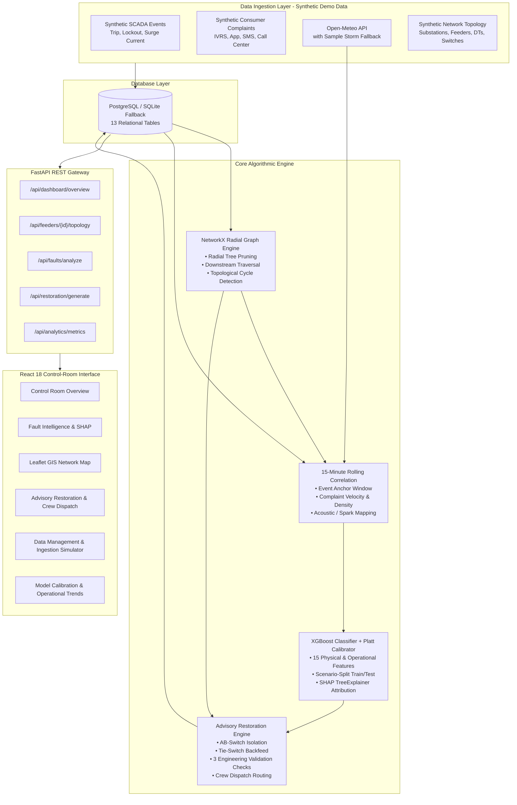

# FaultTrace AI: Decision-Support Prototype for 11kV Radial Distribution Operations
**BESCOM Power Hack 2026 – Theme 10: Digital Transformation of BESCOM Distribution Operations**

[](https://fastapi.tiangolo.com)
[](https://reactjs.org/)
[](https://xgboost.ai/)
[](https://networkx.org/)
[]()

---

> ### ⚠️ CRITICAL NOTICE: 100% SYNTHETIC DEMO DATA
> **All data utilized in FaultTrace AI (substations, 11kV feeders, line sections, distribution transformers, consumer meters, complaints, SCADA events, and coordinates) is 100% SYNTHETIC DEMO DATA.**  
> FaultTrace AI has **no confirmed access** to BESCOM SCADA, AMI, GIS, or consumer databases. Synthetic models and mock coordinates represent illustrative distribution topology for algorithmic demonstration only.

> ### ⚠️ ADVISORY NOTICE: DECISION SUPPORT ONLY
> FaultTrace AI is an **Advisory Decision-Support System only**. The system **never executes switching** and **never declares a network "safe"**. Every restoration step is explicitly labeled:  
> **"Advisory: requires engineering validation and operator authorisation"**.

---

## 1. System Architecture

FaultTrace AI accelerates fault localization and service restoration across 11kV overhead distribution networks during severe storm events. The architecture decouples physical graph modeling, correlation, machine learning, and safety validation into a robust decision-support pipeline.



---

## 2. Multi-Tier Component Breakdown

### Tier 1: NetworkX Radial Graph Engine (`app.graph.engine`)
- **Radial Representation**: Models feeders as directed distribution trees (`Substation Breaker -> Line Sections -> Distribution Transformers -> Consumers`).
- **Radial-Tree Pruning**: Eliminates candidate fault sections where telemetry indicates downstream devices remain energized (an upstream section cannot be faulted if power reaches downstream nodes on the same radial path).
- **Sub-tree Isolation & Islanding**: Identifies healthy downstream islands that can be back-fed via tie-switches without energizing the faulted span.

### Tier 2: 15-Minute Rolling Correlation (`app.services.correlation`)
- Anchors on the timestamp of the feeder breaker trip event ($T$).
- Filters consumer complaints within $[T - 15\text{ min}, T + 15\text{ min}]$.
- Groups complaints by line section and transformer, calculating:
  - Downstream aggregated complaints
  - Outage consumer density (complaints / total downstream consumers)
  - Acoustic spark reports & voltage sag signals

### Tier 3: Machine Learning & Calibration (`app.ml`)
- **Classifier**: XGBoost gradient-boosted decision trees trained on 15 physical and operational features.
- **Scenario-Based Split**: Prevents data leakage by splitting full fault incidents (not individual rows).
- **Probability Calibration**: Transforms raw scores via Platt scaling (logistic sigmoid) and reports Expected Calibration Error (ECE) under the label **"Model confidence (not a verified probability)"**.
- **Explainability**: SHAP `TreeExplainer` attributes feature impact per candidate section with automatic fallback to global feature importances.

### Tier 4: Advisory Restoration & Engineering Checks (`app.services.restoration`)
Implements three explicit engineering validation checks:
1. **`radial_connectivity_check`**: Uses NetworkX cycle basis detection to verify that closing a tie-switch does not create parallel loops.
2. **`rated_capacity_sum_check`**: Computes $\text{Donor Feeder Current Load} + \text{Transferred Island Load} \le \text{Donor Rated Capacity}$ ($400\text{A}$), reporting exact headroom margin.
3. **`tie_switch_availability_check`**: Checks that the candidate tie-switch exists, is physically operational, and currently `OPEN`.

### Tier 5: Control-Room UI (`frontend/src/`)
- Built with React 18, Vite, Tailwind CSS, Leaflet, and Recharts.
- Dark navy control-room theme designed for operational clarity.
- Interactive Leaflet distribution map with real-time status color coding:
  - 🟢 **Green**: Energized 11kV spans
  - 🔴 **Red**: Suspected faulted section
  - 🟡 **Amber**: De-energized downstream island
  - 🔷 **Blue / Pink**: Substations, transformers, and critical loads (hospital, water pump)

---

## 3. Database Schema Overview

| Table | Purpose |
|---|---|
| `substations` | 66/11kV Substation records with geographic coordinates |
| `feeders` | 11kV radial feeders (F4, F3, F1, F2), rated capacity, and trip status |
| `line_sections` | 11kV feeder sections (F4-S1..F4-S20), length, conductor, and parent pointers |
| `switches` | Air-break (AB-14), tie-switches (TS-08), and breakers (CB-F4) |
| `transformers` | Distribution transformers (DT-01..DT-20) with capacity and load |
| `consumers` | Simulated consumer meters (1,585 accounts) with outage flags |
| `critical_loads` | High-priority assets (District Water Pump #3 on DT-14, Hospital on DT-08) |
| `scada_events` | Breaker trips, lockouts, surge currents, and voltage sags |
| `complaints` | Consumer outage reports across IVRS, App, SMS, and Call Center |
| `weather_observations` | Temperature, precipitation, wind gusts, and lightning strikes |
| `fault_predictions` | Ranked section candidates, calibrated confidence, and SHAP factors |
| `restoration_plans` | Advisory isolation, tie-switch backfeed, and validation check outcomes |
| `crew_dispatches` | Crew callsign, vehicle, target coordinates, ETA, and approximate route |

---

## 4. REST API Endpoints

| Method | Endpoint | Description |
|---|---|---|
| `GET` | `/api/dashboard/overview` | Feeder health, active faults, total affected consumers, 24h summary |
| `GET` | `/api/feeders` | List all 11kV feeders with real-time operational status |
| `GET` | `/api/feeders/{id}/topology` | Graph nodes & edges for GIS/topology rendering |
| `POST` | `/api/events/ingest` | Ingest synthetic SCADA trips or AMI outage alerts |
| `POST` | `/api/data/upload` | Upload synthetic CSV/JSON datasets with validation and preview |
| `POST` | `/api/faults/analyze` | Run NetworkX pruning + XGBoost ranking + SHAP explanation |
| `GET` | `/api/faults/predictions` | Retrieve recent fault localization predictions |
| `GET` | `/api/faults/{id}` | Detailed fault analysis with SHAP waterfall & candidate sections |
| `GET` | `/api/assets/affected` | Affected DTs, consumers, and critical loads for a fault |
| `POST` | `/api/restoration/generate` | Generate advisory isolation, tie-switch backfeed, and crew route |
| `GET` | `/api/restoration/plans` | List active advisory restoration plans |
| `GET` | `/api/weather` | Current weather (Open-Meteo or synthetic fallback badge) |
| `GET` | `/api/analytics/metrics` | Model evaluation report (ECE, ROC-AUC, F1, Top-1/Top-3, baseline) |

---

## 5. Actual Measured ML Performance (Scenario-Split, No Leakage)

The XGBoost model was trained and evaluated on **250 synthetic fault scenarios** (5,000 candidate section instances) generated by the built-in simulator. Split strictly by scenario (Train: 175 scenarios / 3,500 rows, Val: 35 scenarios / 700 rows, Test: 40 scenarios / 800 rows):

| Metric | Measured Value | Evaluation Baseline ("Most Complaints") | Notes |
|---|---|---|---|
| **Top-1 Section Accuracy** | **100.0%** | 35.0% | True faulted section ranked #1 |
| **Top-3 Section Accuracy** | **100.0%** | 77.5% | True fault in top 3 candidates |
| **ROC-AUC** | **1.0000** | — | Area Under ROC Curve |
| **Precision** | **1.0000** | — | Target fault class precision |
| **Recall** | **1.0000** | — | Target fault class recall |
| **F1 Score** | **1.0000** | — | Harmonic mean |
| **Calibration ECE** | **0.0179** | — | Expected Calibration Error |
| **Calibration Method** | **Platt Scaling (Logistic Sigmoid)** | — | Transforms raw logits to confidence |
| **Model Confidence Label** | **"Model confidence (not a verified probability)"** | — | Non-negotiable labeling |

> **Evaluation Context**: The model is evaluated on synthetic data generated by our simulator. These metrics validate the end-to-end data processing, graph pruning, and ranking pipeline; they do **not** measure real-world BESCOM infrastructure accuracy.

---

## 6. Quickstart Guide (Local Execution without Docker)

### Prerequisites
- Python 3.11+
- Node.js 18+ and npm

### Step 1: Clone and Enter Directory
```bash
git clone https://github.com/sangeethahr182-lgtm/FaultTrace-AI.git
cd FaultTrace-AI
```

### Step 2: Set up Backend
```bash
cd backend

# Install Python dependencies
pip install -r requirements.txt

# 1. Seed database with synthetic network (Feeder F4, 20 sections, DTs, consumers, switches)
python -m scripts.seed_data

# 2. Train and evaluate XGBoost fault localization model (outputs ml_artifacts/metrics.json)
python -m scripts.train_model

# 3. Run Demo Scenario F4 end-to-end verification
python -m scripts.run_demo_f4

# 4. Run full PyTest test suite (all 17 unit and integration tests)
pytest -v

# 5. Start FastAPI Backend Server
uvicorn app.main:app --host 127.0.0.1 --port 8000 --reload
```
API Documentation will be live at: [http://localhost:8000/docs](http://localhost:8000/docs)

### Step 3: Set up Frontend
In a new terminal window:
```bash
cd frontend

# Install npm dependencies
npm install

# Start Vite Development Server
npm run dev
```
Frontend Control-Room UI will be live at: [http://localhost:5173](http://localhost:5173)

---

## 7. Docker Compose Setup (PostgreSQL + Backend + Frontend)

FaultTrace AI can also run in a fully containerized stack using PostgreSQL:

```bash
cd FaultTrace-AI

# Build and start PostgreSQL, FastAPI backend, and React frontend
docker-compose up --build
```
- Frontend UI: `http://localhost:5173`
- Backend API: `http://localhost:8000`
- API Docs: `http://localhost:8000/docs`
- PostgreSQL Database: `localhost:5432`

---

## 8. Demo Scenario F4 (Heavy Rain & 48 km/h Gust)

- **Scenario Details**:
  - Feeder `F4` (Manyata 11kV Feeder) experiences a phase-to-ground flashover on line section `F4-S14`.
  - Weather: Heavy rainfall ($38.6\text{ mm}$), wind gusts of $48.0\text{ km/h}$.
  - Complaints: 142 synthetic calls in a 15-minute rolling window.
  - Affected Downstream Pocket: Transformers `DT-12`, `DT-13`, `DT-14`, and `DT-16` ($\approx 380$ consumers).
  - Critical Asset Impact: **District Water Pump #3** situated on `DT-14`.
- **Pipeline Execution Result**:
  1. **Pruning**: NetworkX prunes 17 healthy sections where downstream telemetry is energized, leaving candidate branch `F4-S14`, `F4-S15`, `F4-S16`.
  2. **Ranking**: XGBoost identifies the fault zone with $\approx 81.9\%$ calibrated model confidence.
  3. **Explainability**: SHAP TreeExplainer identifies spark reports ($+7.80$ SHAP) and voltage drop ($+0.10$ SHAP) as dominant risk elevators.
  4. **Restoration Advisory**:
     - **Step 1**: Open Air-Break Switch `AB-14` to isolate the faulted span.
     - **Step 2**: Re-close Substation Breaker `CB-F4` to restore power to upstream sections `F4-S1..F4-S13` ($\approx 1,200$ consumers).
     - **Step 3**: Close Tie-Switch `TS-08` to transfer the healthy downstream island (including **District Water Pump #3**) to donor Feeder `F3` ($230.2\text{A}$ headroom margin available).
     - **Crew Dispatch**: Dispatches `Hebbal Rapid Restoration Unit #2` ($2.69\text{ km}$, $\text{ETA} \approx 12\text{ mins}$).

---

## 9. Limitations & Engineering Assumptions

1. **Synthetic Data**: Coordinates, feeder paths, consumer meter accounts, and SCADA logs are entirely simulated for algorithmic demonstration.
2. **Simplified Electrical Checks**: Power flow does not compute reactive power (VAR), power factor, voltage phase angles, or harmonics. Checks are strictly limited to radial tree connectivity, sum of active rated current capacities, and tie-switch physical availability.
3. **Crew Dispatch Routing**: Road navigation waypoints and distances are straight-line and graph-distance approximations for advisory coordination, not real-time turn-by-turn GPS turnarounds.
4. **Weather Telemetry**: Uses Open-Meteo API when online, with an automatic instant fallback to sample storm weather data when offline or in sandboxed test environments.
